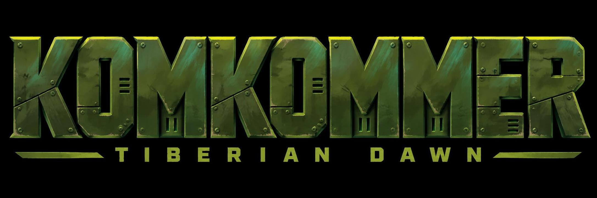
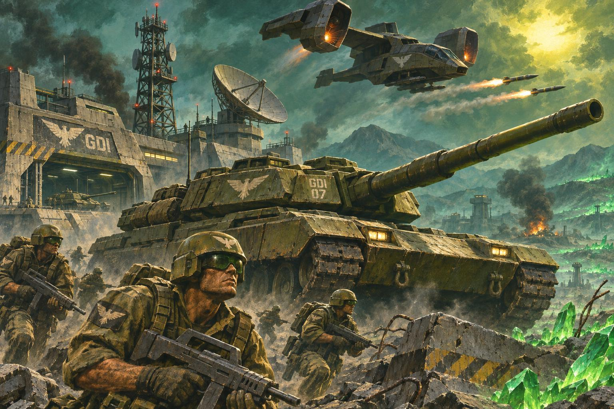
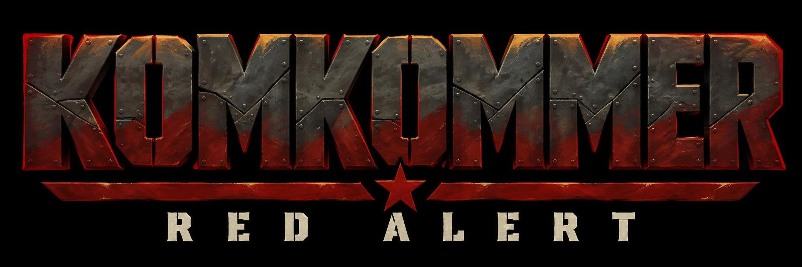
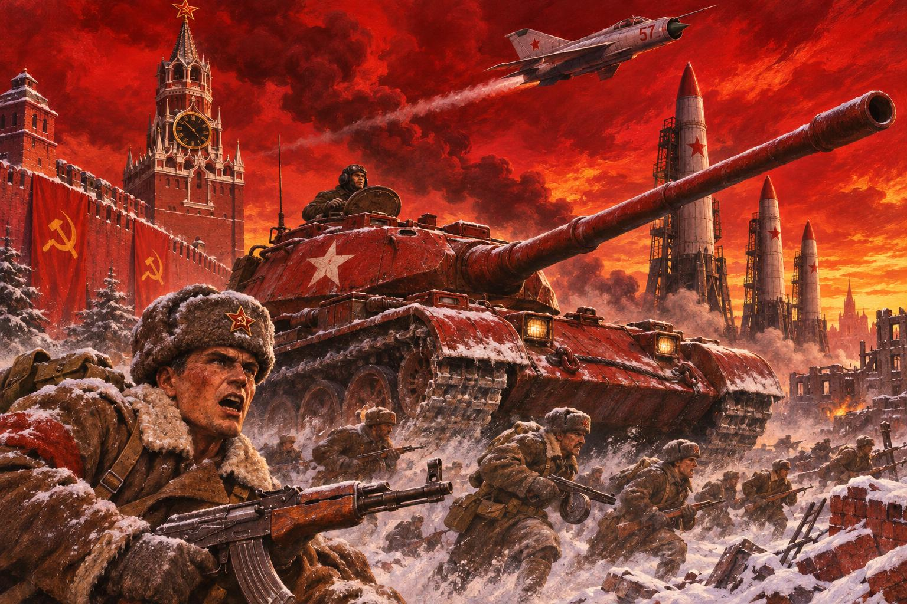

# Prompts

| Title | Prompt | Result (gpt-image-2.6-sunburst) |
| --- | --- | --- |
| Tiberian Dawn Logo | Design a standalone title logo for a military strategy game. Exact main text: “KOMKOMMER”. Exact subtitle: “Tiberian Dawn”. Capture the visual character of richly painted 1990s PC military game packaging. Build a distinctive, readable wordmark with strong silhouettes and deliberate custom lettering. Keep KOMKOMMER dominant and the smaller subtitle clearly separated beneath it. Preserve the same main wordmark geometry across both editions. Isolated on a plain near-black background. Front-facing presentation. No battlefield, characters, vehicles, mockup, extra wording or watermark. Avoid copying existing game logos. The design must remain recognisable as a flat, single-colour silhouette. Use massive condensed uppercase letters constructed like interlocking armour plates. Squared forms, clipped corners, narrow spacing and a few purposeful stencil cuts. Dark painted steel with restrained edge wear and shallow recessed seams. Monumental and intimidating, with painterly highlights rather than glossy bevels. Set the subtitle in small, widely spaced military lettering. Olive-green armour, deep emerald shadows, teal reflected light and sickly yellow-green rim lighting. Sparse mineral-green accents in recessed details. |  |
| Tiberian Dawn | Create a cinematic military sci-fi war illustration inspired by Command & Conquer: Tiberian Dawn, rendered as richly detailed, painterly 1990s PC game cover art. A massive olive-green battle tank dominates the foreground, viewed from a low three-quarter angle, its long cannon pointing diagonally toward the upper right. Helmeted infantry carrying assault rifles advance through broken rocks and battlefield rubble in the lower foreground. Behind the tank stands a weathered military-industrial base with a tall lattice communications tower and a large satellite dish. A heavy futuristic twin-engine orca gunship (think apache helicopter but 208x without rotors -- just jet engines that can pivot and fires missiles only) flies overhead. Deep emerald shadows, teal atmosphere, sickly yellow-green sunlight, smoky haze, dramatic backlighting, battered armour, gritty textures, strong silhouettes and epic scale. Dense, layered composition with crisp foreground detail and atmospheric depth. Full-bleed rectangular artwork extending to every edge. |  |
| Red Alert Logo | Design a standalone title logo for a military strategy game. Exact main text: “KOMKOMMER”. Exact subtitle: “Red Alert”. Capture the visual character of richly painted 1990s PC military game packaging. Build a distinctive, readable wordmark with strong silhouettes and deliberate custom lettering. Keep KOMKOMMER dominant and the smaller subtitle clearly separated beneath it. Preserve the same main wordmark geometry across both editions. Isolated on a plain near-black background. Front-facing presentation. No battlefield, characters, vehicles, mockup, extra wording or watermark. Avoid copying existing game logos. The design must remain recognisable as a flat, single-colour silhouette. Use massive condensed uppercase letters constructed like interlocking armour plates. Squared forms, clipped corners, narrow spacing and a few purposeful stencil cuts. Dark painted steel with restrained edge wear and shallow recessed seams. Monumental and intimidating, with painterly highlights rather than glossy bevels. Set the subtitle in small, widely spaced military lettering. Dark gunmetal and oxblood-red paint, deep black shadows, scarlet edge lighting and restrained orange-gold highlights. Cold ivory subtitle. |  |
| Red Alert | Create a cinematic alternate-history Soviet war illustration inspired by Command & Conquer: Red Alert, rendered as richly detailed, painterly 1990s PC game cover art. A massive red Soviet battle tank with white star markings dominates the foreground, viewed from a low three-quarter angle, its long cannon pointing diagonally toward the upper right. Winter-uniformed infantry with rifles charge across snow-covered rubble, with a prominent ushanka-wearing soldier close to the viewer. Behind them rise a Kremlin-style clock tower and a cluster of tall upright ballistic missiles. A mig "clears the skies" overhead. An incandescent scarlet sky, orange-gold horizon, crimson smoke, deep black shadows and cold white snow. Dramatic wartime lighting, battered steel, gritty textures, strong silhouettes and monumental scale. Dense, layered composition with atmospheric depth. Full-bleed rectangular artwork extending to every edge.|  |
